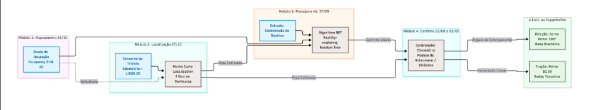
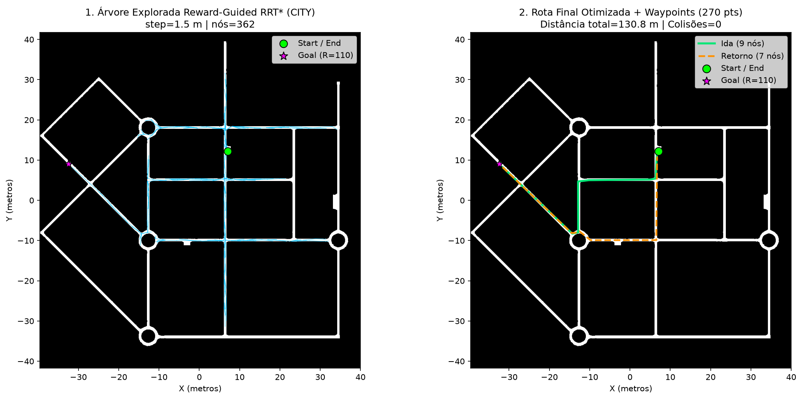

# Projeto VINI — Robô Móvel Autônomo (Projeto Final)

Repositório do projeto final da disciplina contendo a modelagem mecânica 3D (SolidWorks), as cenas de simulação (CoppeliaSim), o pipeline de navegação autônoma (Mapeamento, Localização MCL, Planejamento RRT e Controle Cinemático) e a teleoperação via manete USB do triciclo **V.I.N.I.**.



---

## Estrutura do Projeto

```text
Project_VINI/
├── projeto_final_vini.ipynb                    # Notebook principal do Projeto Final (Módulos 1 a 4)
├── mapeamento/                                 # Módulo 1 & 2: Grades de Ocupação 2D, Calibração e Likelihood Field
│   ├── mapa_cidade.jpg                         # Vista superior original do cenário urbano
│   ├── Occupancy_Grid_-_Terminal_Update.png    # Occupancy Grid exploratório de referência do CoppeliaSim (84m x 84m)
│   ├── grid_rrt.npy                            # Camada de Navegação calibrada 180° (0=Asfalto Livre C-Space, 1=Ocupado)
│   ├── grid_mcl.npy                            # Camada de Obstáculos Físicos 3D calibrada 180° p/ LiDAR (0=Livre, 1=Prédios)
│   ├── mapa_rrt_pb_coppelia.png                # Camada de Navegação em PNG P&B puro (255=Livre, 0=Ocupado, 180° CoppeliaSim)
│   ├── mapa_rrt_pb.png                         # Camada de Navegação em PNG P&B puro (orientação original)
│   ├── map_config.json                         # Metadados calibrados (resolution, origin_x, origin_y, marcos das rotatórias)
│   ├── likelihood_field_mcl.png                # Mapa de distância até prédios 3D para o MCL
│   ├── visualizacao_mapas.png                  # Comparativo visual das camadas segmentadas
│   ├── validacao_calibracao.png                # Validação da sobreposição calibrada e mapa P&B exportado
│   └── pipeline_arquitetura.png                # Diagrama de blocos da arquitetura do sistema
├── hydrone-sim-python/                         # Módulo 3: Planejador Reward-Guided RRT* e cenários YAML
│   ├── Reward_Guided_RRT.py                    # Algoritmo principal Reward-Guided RRT*
│   ├── run_simulation.py                       # Execução interativa de uma simulação única
│   ├── data_acquisition.py                     # Bateria automatizada de simulações para coleta de dados
│   ├── scenerys.yaml                           # Definição dos cenários (SIMPLE_BOX, LARGE_PTP, CITY)
│   └── ...                                     # Módulos auxiliares (class_map, bias_roulett, cost_map, viz, etc.)
├── planejamento/                               # Saídas calibradas do Módulo 3 para o Módulo 4
│   ├── waypoints_rrt.csv                       # Trajetória reamostrada (x, y, theta, phase) a cada 0,5 m
│   ├── waypoints_rrt.npy                       # Matriz NumPy (N, 3) com [x, y, theta] livre de colisões
│   └── rota_rrt_planejada.png                  # Visualização da árvore explorada e rota final (ida + retorno)
├── cad_solidworks/                             # Peças (.SLDPRT) e montagem completa (.SLDASM) no SolidWorks
│   ├── Montagem_VINI.SLDASM                    # Montagem principal do robô VINI
│   └── *.SLDPRT                                # Peças do chassi, direção, rodas, hubs e servo MG996R
├── simulacao_coppeliasim/                      # Cenas de simulação do CoppeliaSim (.ttt)
│   ├── Cena_Cidade-VINI.ttt                    # Cena urbana completa com o robô VINI
│   └── Novo_modelo_Cena.ttt                    # Cena do modelo atualizado do VINI
├── controle/                                   # Teleoperação via manete USB (Xbox / Gamepad) via ZMQ Remote API
│   ├── controle_manete_vini.ipynb              # Jupyter Notebook interativo de teleoperação
│   └── controle_manete_vini.py                 # Script Python standalone para execução direta no terminal
├── requirements.txt                            # Dependências Python do projeto
└── .gitignore                                  # Ignora arquivos temporários do SolidWorks (~$*), Jupyter e Python
```

---

## Módulos do Sistema Autônomo ([projeto_final_vini.ipynb](projeto_final_vini.ipynb))

1. **Módulo 1 — Mapeamento e Calibração (`mapeamento/`, Células 1 a 6)**:
   - Processa a vista superior do cenário urbano do CoppeliaSim (`mapa_cidade.jpg`) gerando duas grades binárias alinhadas (`1024 x 976`), rotacionadas em **180°** para corresponder à orientação real do simulador:
     - `grid_rrt.npy`: Camada de navegação com asfalto contínuo (`cv2.MORPH_CLOSE`) e inflação C-Space (`2 px` / `0,163 m`) para manter distância segura do meio-fio.
     - `grid_mcl.npy`: Camada física contendo exclusivamente os **20 prédios 3D** que refletem o laser do `fastHokuyo`.
     - `mapa_rrt_pb_coppelia.png` (e `mapa_rrt_pb.png`): Mapas de navegação em PNG preto e branco puro (`255` = livre, `0` = ocupado, sem bordas ou eixos) prontos para consumo direto pelo planejador RRT.
     - `map_config.json`: Parâmetros calibrados automaticamente via centros das 4 rotatórias sobre o Occupancy Grid de referência do CoppeliaSim (`resolution = 0,08153 m/px`, `origin_x = -39,5724 m`, `origin_y = -41,7430 m`, erro máximo de `2,8 cm`) para transformação $(x, y) \leftrightarrow (col, row)$.
   - 
2. **Módulo 2 — Localização Probabilística (`MCL / Filtro de Partículas`, Células 7 a 9)**:
   - Pré-calcula o **Likelihood Field** (`dist_field_m`) em metros a partir de `grid_mcl.npy` usando `cv2.distanceTransform`.
   - Implementa a classe vetorizada `ParticleFilterMCL` (modos *Tracking* e *Global*, predição odométrica, atualização por campo de verossimilhança e *Low-Variance Resampling*).
   - Inclui loop de validação em tempo real no CoppeliaSim (`HokuyoSensorSim` via ZMQ Remote API) comparando trajetória estimada vs. *ground truth*.
3. **Módulo 3 — Planejamento de Caminhos (`Reward-Guided RRT*`, Células 10 e 11)**:
   - Integra diretamente o planejador em `hydrone-sim-python/` (`CalibratedCityRRT`) alinhado aos limites calibrados do `map_config.json` e ao `mapa_rrt_pb_coppelia.png`, com checagem de colisão sub-pixel e amostragem sobre a malha viária livre (`grid_rrt == 0`).
   - Plota a árvore explorada e a rota final (ida + retorno) e exporta os *waypoints* reamostrados (`planejamento/waypoints_rrt.csv` e `waypoints_rrt.npy`) livres de colisões para o controle.
   - 
4. **Módulo 4 — Controle Cinemático (`Modelo Bicicleta / Pure Pursuit`, Células 12 a 14)**:
   - **Célula 12**: implementa o controlador `PurePursuitController` (modelo cinemático bicicleta/Ackermann com janela de busca progressiva, parada por `stop_pt`/`stop_tol` e redução automática de velocidade em curvas).
   - **Célula 13 (Cenário 1 — Rota Simples até o Goal)**: fecha a malha no CoppeliaSim seguindo `planejamento/waypoints_rrt.npy` até o objetivo com MCL, `HokuyoSensorSim` vetorizado e suavização de esterçamento (`planejamento/navegacao_autonoma_final.png`).
   - **Célula 14 (Cenário 2 — Circuito Urbano Completo)**: percorre um circuito fechado com múltiplos *waypoints* pela cidade densificados a cada `0,5 m` (`planejamento/navegacao_cidade_final.png`).
