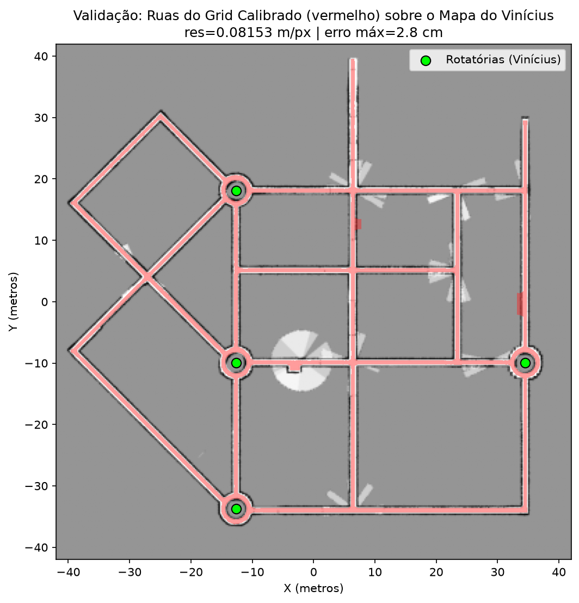

# Projeto VINI — Robô Móvel Autônomo (Projeto Final)

Repositório do projeto final da disciplina contendo a modelagem mecânica 3D (SolidWorks), as cenas de simulação (CoppeliaSim), o pipeline de navegação autônoma (Mapeamento, Localização MCL, Planejamento RRT e Controle Cinemático) e a teleoperação via manete USB do triciclo **V.I.N.I.**.


---

## Estrutura do Projeto

```text
Project_VINI/
├── projeto_final_vini.ipynb                    # Notebook principal do Projeto Final (Módulos 1 a 4)
├── mapeamento/                                 # Módulo 1: Grades de Ocupação 2D e Calibração
│   ├── mapa_cidade.jpg                         # Vista superior original do cenário urbano
│   ├── Occupancy_Grid_-_Terminal_Update.png    # Occupancy Grid exploratório de referência do CoppeliaSim (84m x 84m)
│   ├── grid_rrt.npy                            # Camada de Navegação calibrada 180° (0=Asfalto Livre C-Space, 1=Ocupado)
│   ├── grid_mcl.npy                            # Camada de Obstáculos Físicos 3D calibrada 180° p/ LiDAR (0=Livre, 1=Prédios)
│   ├── mapa_rrt_pb_coppelia.png                # Camada de Navegação em PNG P&B puro (255=Livre, 0=Ocupado, 180° CoppeliaSim)
│   ├── mapa_rrt_pb.png                         # Camada de Navegação em PNG P&B puro (orientação original)
│   ├── map_config.json                         # Metadados calibrados (resolution, origin_x, origin_y, marcos das rotatórias)
│   ├── visualizacao_mapas.png                  # Comparativo visual das camadas segmentadas
│   ├── validacao_calibracao.png                # Validação da sobreposição calibrada e mapa P&B exportado
│   └── pipeline_arquitetura.png                # Diagrama de blocos da arquitetura do sistema
├── cad_solidworks/                             # Peças (.SLDPRT) e montagem completa (.SLDASM) no SolidWorks
│   ├── Montagem_VINI.SLDASM                    # Montagem principal do robô VINI
│   └── *.SLDPRT                                # Peças do chassi, direção, rodas, hubs e servo MG996R
├── simulacao_coppeliasim/                      # Cenas de simulação do CoppeliaSim (.ttt)
│   ├── Cena_Cidade-VINI.ttt                    # Cena urbana completa com o robô VINI
│   └── Novo_modelo_Cena.ttt                    # Cena do modelo atualizado do VINI
├── controle/                                   # Teleoperação via manete USB (Xbox / Gamepad) via ZMQ Remote API
│   ├── controle_manete_vini.ipynb              # Jupyter Notebook interativo de teleoperação
│   └── controle_manete_vini.py                 # Script Python standalone para execução direta no terminal
├── requirements.txt                            # Dependências Python do projeto
└── .gitignore                                  # Ignora arquivos temporários do SolidWorks (~$*), Jupyter e Python
```

---

## Módulos do Sistema Autônomo ([projeto_final_vini.ipynb](projeto_final_vini.ipynb))

1. **Módulo 1 — Mapeamento e Calibração (`mapeamento/`)**:
   - Processa a vista superior do cenário urbano do CoppeliaSim (`mapa_cidade.jpg`) gerando duas grades binárias alinhadas (`1024 x 976`), rotacionadas em **180°** para corresponder à orientação real do simulador:
     - `grid_rrt.npy`: Camada de navegação com asfalto contínuo (`cv2.MORPH_CLOSE`) e inflação C-Space (`2 px` / `0,163 m`) para manter distância segura do meio-fio.
     - `grid_mcl.npy`: Camada física contendo exclusivamente os **20 prédios 3D** que refletem o laser do `fastHokuyo`.
     - `mapa_rrt_pb_coppelia.png` (e `mapa_rrt_pb.png`): Mapas de navegação em PNG preto e branco puro (`255` = livre, `0` = ocupado, sem bordas ou eixos) prontos para consumo direto pelo planejador RRT.
     - `map_config.json`: Parâmetros calibrados automaticamente via centros das 4 rotatórias sobre o Occupancy Grid de referência do CoppeliaSim (`resolution = 0,08153 m/px`, `origin_x = -39,5724 m`, `origin_y = -41,7430 m`, erro máximo de `2,8 cm`) para transformação $(x, y) \leftrightarrow (col, row)$.
   - 
2. **Módulo 2 — Localização Probabilística (MCL / Filtro de Partículas)** *(em desenvolvimento)*
3. **Módulo 3 — Planejamento de Caminhos (RRT com restrição cinemática)** *(em desenvolvimento)*
4. **Módulo 4 — Controle Cinemático (Modelo Bicicleta / Ackermann)** *(em desenvolvimento)*
